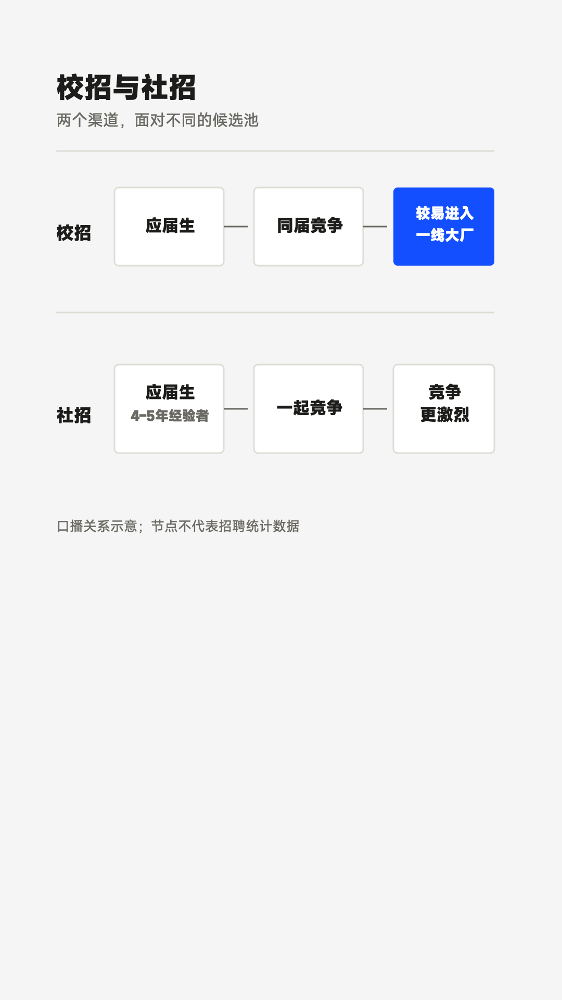
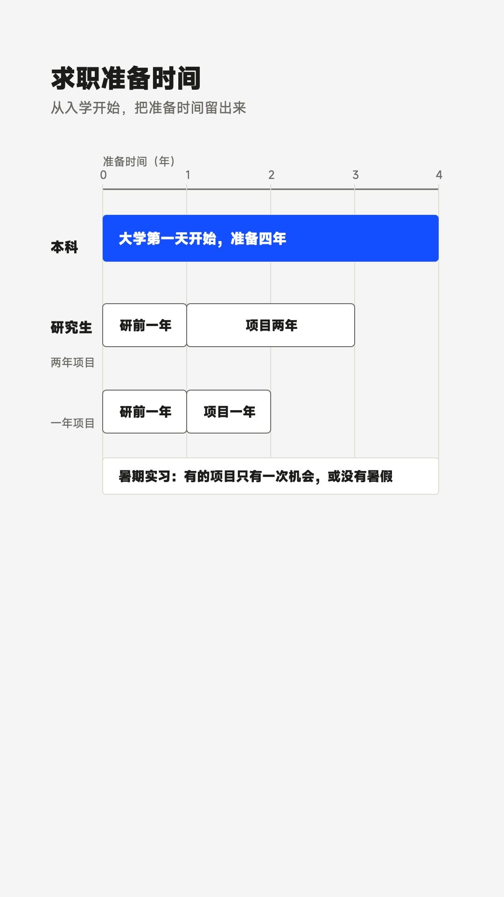
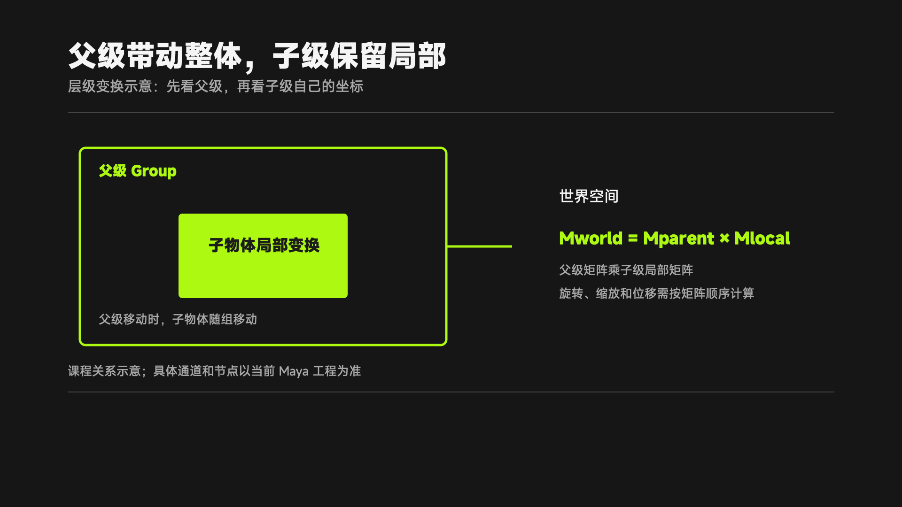
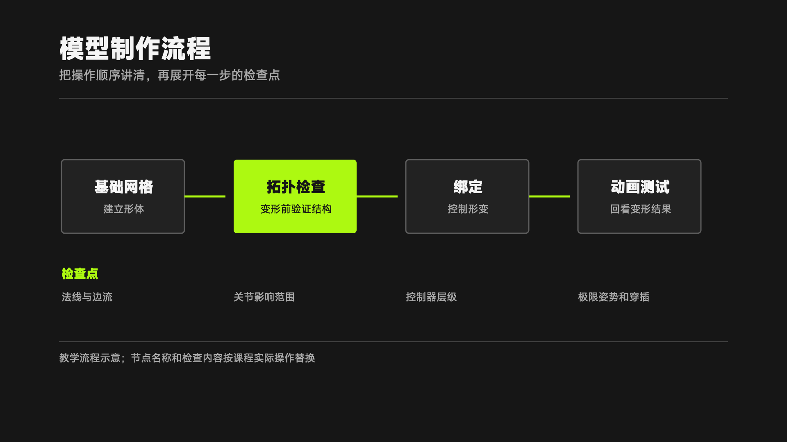

# video-edit

OpenCode 的 HyperFrames 剪辑 skill：把课程录屏、直播回放和口播素材做成可编辑工程与 9:16 成片，覆盖 MAXs、技研Labs、LeonaDesign。当前版本 `1.3.2`。

粗剪决策、简体字幕、账号包装、图解与渲染都留在同一个可编辑工程里；最终视觉验收由你在 HyperFrames Studio 完成。

## 安装

需要 Node.js 22+、FFmpeg 和 Chrome Headless Shell。

```bash
npx skills add https://github.com/zzh-editor/MAXs_VideoEditor \
  --skill video-edit --global --agent opencode --copy --yes
```

安装器可能放在 `~/.agents/skills/` 或 `~/.config/opencode/skills/`。首次使用前检查依赖，只补缺少项：

```bash
SKILL_DIR="$HOME/.agents/skills/video-edit"
test -f "$SKILL_DIR/SKILL.md" || SKILL_DIR="$HOME/.config/opencode/skills/video-edit"
python3 "$SKILL_DIR/scripts/ensure_dependencies.py" --check
python3 "$SKILL_DIR/scripts/ensure_dependencies.py" --install-missing
```

依赖清单在 [`references/dependencies.json`](references/dependencies.json)。HyperFrames 的格式、确定性时间线与工具契约来自 `hyperframes` / `hyperframes-cli`；MAXs 动效节奏、A-roll/PIP 组织和图解规则写在本技能内。账号色彩、安全框、字幕规范、图解规则和 4 组可编辑 SVG 原稿随包安装；`diagram-design`、`lieflat-charts`、`pixelfx` 只是可选补充，不阻塞基础安装。

渲染缺浏览器时运行 `npx hyperframes doctor --json` 检查、`npx hyperframes browser ensure` 安装。Premiere Pro 导入是可选步骤。

## 工作流

1. **导入与一次性确认。** 检查媒体信息、同目录 SRT、已有工程和源片烧录文字；工程默认放 `<视频文件名>-hyperframes/`。账号、类型、剪辑范围、转写/润色、图解、交付按 [`references/preflight.md`](references/preflight.md) 一次问完并写入 `BRIEF.md`，已说清的字段不重复问。
2. **原始索引。** 用户指定的 SRT 为文本来源；有效就复用，缺可靠字幕才调 `video-transcribe`。
3. **保守精剪。** 口吃、自纠改口、说完又否定的重复默认列入删除；伤论点、教学操作或指代时才保留并写明原因。VAD/静音只给候选。🔴 只在问卷预批准范围内执行，超出时只问差异项。
4. **字幕对时。** 按同一剪辑清单调 [`scripts/retime.py`](scripts/retime.py)；跨剪切点用可靠词级时间，词级数据复用 `video-transcribe` 的引擎和环境，不另建转写环境。引擎不可用或没有词级时间时保留整句或挂起待确认，不改时间戳把条目塞进保留区间。
5. **内容扫描与 b-roll 提案。** 字幕定稿后必做一次，生成精简 cue-map 复用。候选写清字幕编号、源时间、主张、视觉关系、预计时长、受众标签与数字 cue；🔴 授权按问卷预批准处理，否则停下问。
6. **包装与图解。** 文案按 [`references/copy-writing.md`](references/copy-writing.md) 七条与交付前四问：标题写观众所得、主标题 ≤7 字并挂受众标签、一图一结论、数字走 `BRIEF.md` 口径、`cards.json` 记 `number_cue`/`claim_cue`。标题是问句或前 15 秒抛问句时用提问卡两段式，全片一次。相邻图解段停留会超 5 秒时先回全屏 A-roll。
7. **检查与交付。** 迭代用 `lint`，一批改完或出片前跑 `check --json`，通过后抽首帧与受影响图解的入场/中段/退场读图。再 `npx hyperframes preview --background` 交 URL，预览不等于验收。授权后渲染，成功后只用 `ffprobe` 核对容器信息与配套 SRT 同源。

细则见 [`SKILL.md`](SKILL.md) 与 [`references/`](references/)。

## 交付物

`renders/` 下每版一套：MP4（默认烧录字幕）+ 同名简体 SRT + `_续编说明.txt`。同名文件已存在时递增 `_v2`、`_v3`，不覆盖旧件。源视频、原始 SRT 与 Studio 中的手工编辑都不覆盖。

## MAXs

- 强调色只有 `#134FFF`，蓝底白字；常规图解用白或纸灰底、黑灰文字，蓝色只点 1–2 个焦点。
- 新增文字用 MiSans VF。不加渐变、阴影、装饰图例，不为视觉效果虚构数据。
- 9:16 图表主体在 `x=10%–88%`、`y=8%–59%`；全屏 A-Roll 是口播常态，图解需要阅读时才缩成右下 PIP，结束后在自然口播边界回全屏。
- 字幕内强调用蓝底白字，词句必须来自原字幕。漂浮花字、抠像、持续慢推、自动 punch-in 都不是默认包装。
- 标题板要盖住源片烧录的福利卡：每条素材先抽 3–5 帧找文字边界，不假定在左上角；PIP 时仍要盖住。
- MAXs 中文竖版落版可供技研Labs 共用作片尾；按画幅与语言选获准素材，检查尺寸、时长与音轨后接在 A-Roll 后，不依赖某台机器的固定路径。
- 剪辑保留完整论点、操作步骤与必要反应；开场 Hook 取自口播中的真实主张，不默认加品牌片头。

| 校招与社招候选池 | 求职准备时间线 |
|---|---|
|  |  |

## 技研Labs

- 唯一强调色 `#ADF911`，绿焦点配黑字；图解活动段用 `#161616` 全画幅底，配白/灰字与低对比结构线，不把亮绿铺满整页。
- 新增文字用 MiSans VF。横屏图解底部留至少画面高度 19% 的字幕带，竖屏按高度同比换算；连线与动画行程同样避开。
- 一个图解只讲一个主关系，节点数量跟内容走；没有数据不用统计图，不造指标。
- 课程/直播用固定两行透明片头与 Swoosh，视频和原声从 0 秒连续播放、片头不增加时长；口播默认不加。
- 剪辑不能切断操作因果：输入、参数、执行结果与错误反馈留在同一段叙述里；“怎么设”和“看到什么结果”不剪散。

| Maya 父级与子级 | 模型制作流程 |
|---|---|
|  |  |

静态示例仅作风格参考，SVG 原稿在 [`examples/diagrams/`](examples/diagrams/)；具体图解按当条素材重画并跟 cue 定时。

## LeonaDesign

- 强调色 `#FEF201` 配黑字；不复用其他账号的 Logo 和品牌素材。
- 新增文字同样用 MiSans VF，图解依据只取字幕与课程材料。

## 测试与维护

在仓库根目录：

```bash
python3 -m unittest discover -s skills/video-edit/tests
python3 skills/video-edit/scripts/ensure_dependencies.py --check
python3 ~/.agents/skills/darwin-skill/scripts/darwin.py check skills/video-edit
```

`trigger-tests.json` 是 description 的触发测试集（5 条该触发、5 条相邻），改 description 后重跑。

`lieflat-charts` 使用 PolyForm Noncommercial：本技能只引用其公开视觉原则，不复制代码、模板与素材。Premiere 服务与 MAXs 官方落版素材不随仓库提供，缺少时按需索取，不依赖个人电脑绝对路径。

仓库未声明整体许可证。MiSans VF 与 Swoosh 是随包的用户提供资产，公开分发或用于其他品牌前请先确认授权。
